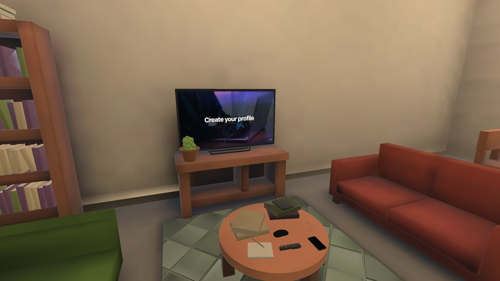
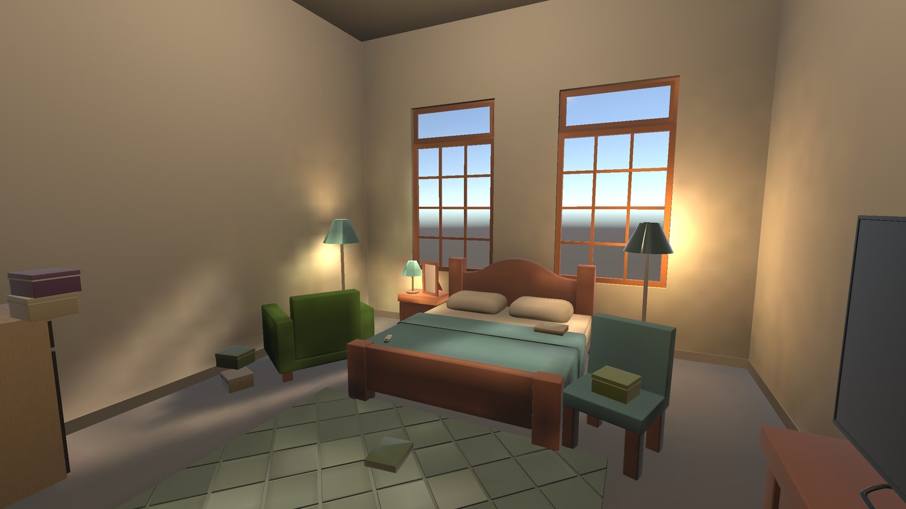
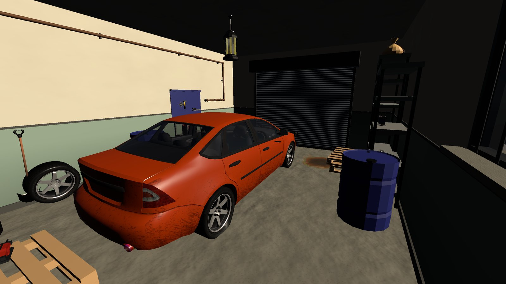
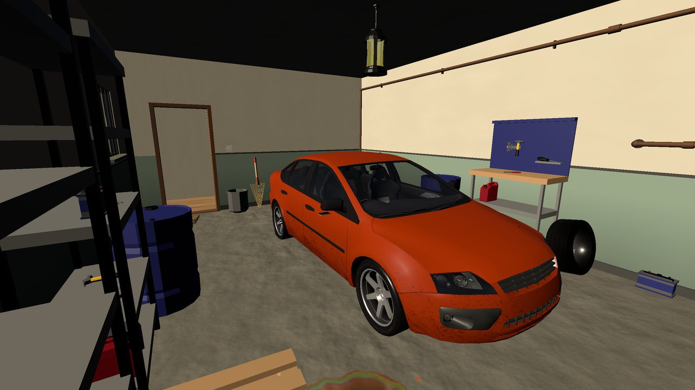
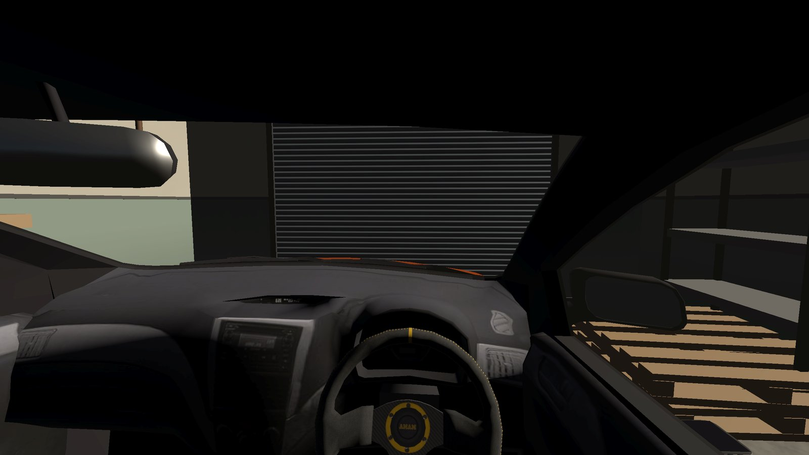

# Jugaad Wala Ghar

A physics-based VR puzzle game for **Meta Quest** where nothing in the house works properly, and you fix everything the Indian way: with **jugaad**.

Made solo in Unity. It started as a 48-hour game jam entry (theme: *JUGAAD*) and grew into a two-level game prepared for the Meta Horizon Store.

## Screenshots

| | |
|---|---|
|  |  |
|  |  |

## Gameplay

**Level 1 – The House (6 tasks).** Mummy's news is about to start, the doors are locked, the bedroom is dark and the fan won't run. Turn on the TV, pick a lock with a safety pin, fish a key out with a magnet, and get the bedroom ready before Mummy rings the doorbell.

**Level 2 – The Garage (12 tasks).** The next day Papa needs the car. Make the oil spill safe, start the old car, jack it up, swap the flat tyre with a spanner and the spare, and drive it out.

- Hands-on physics: grab, twist, crank, steer and drive
- Voiced phone calls with subtitles in **English** or **Hinglish**
- Stuck? A hint appears on your in-game phone after a while (it costs a few points)
- Score, time and 1–3 stars per level, with your best result saved
- Comfort options: smooth or teleport movement, smooth or snap turning

## Controls

| Input | Action |
|---|---|
| Left stick | Move (teleport mode: push to aim, release to jump) |
| Right stick | Turn |
| Grip | Grab and hold objects |
| Trigger | Use what you're holding (remote, phone call, torch) |
| Index finger | Press switches and 3D buttons |
| B (right) | Take out / put away the phone (hints) |
| A (right) | Get in / out of the car |
| Menu (left) | Pause menu and settings |

**In the car:** turn the key to start, left trigger to accelerate, right trigger to brake (hold to reverse), grab the steering wheel to steer.

## Play on Meta Quest

Supported headsets: Quest 2, Quest 3, Quest 3S and Quest Pro.

- **Sideload the APK:** see **[INSTALL.md](INSTALL.md)**, or the [PDF sideloading guide](docs/Meta-Quest-APK-Sideloading-Guide.pdf).

## Open the project

1. Install **Unity 6000.0.74f1** with **Android Build Support** (OpenJDK, Android SDK and NDK).
2. Unity Hub > Add > Add project from disk > select this folder. The first import takes a while.
3. Switch platform to **Android** (File > Build Profiles).
4. Scenes: `Assets/Scenes/MainMenu.unity` (start), `Assets/Scenes/Level1_Home.unity` and `Assets/Scenes/Garage.unity`.

> Some 3D models come from third-party Unity Asset Store packs that are not included in this repository. The project opens without them, but a few props and the car will show as missing until those packs are added. If Unity reports a missing local package in `Packages/manifest.json`, remove that line; the game does not depend on it.

## Build

File > Build Profiles > Android > Build.

Release builds are signed with a private keystore that is **not** part of this repository. To build your own APK, create a keystore in *Player Settings > Publishing Settings*, or switch to the debug keystore.

**Tech:** Unity 6 (URP), XR Interaction Toolkit 3, OpenXR (Meta Quest), IL2CPP ARM64, Vulkan, target API 34.
